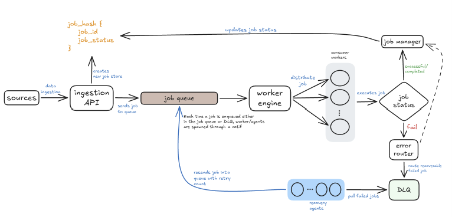

# Task Mesh

**An autonomous distributed task processing engine with an LLM-powered Dead-Letter Queue.**

---

## The problem

In asynchronous distributed pipelines, worker tasks fail when inputs or tool parameters
suffer from **schema drift**, malformed payloads, or bad data types. Standard systems
retry endlessly or dump the task in a Dead-Letter Queue for manual triage, where it sits
indefinitely until a human intervenes.

Standard retry mechanisms (exponential backoff) only solve transient network glitches.
They cannot resolve payload-level schema mismatches, missing required arguments, or tool
contract violations.

## The approach

Task Mesh pairs conventional distributed-systems primitives — Redis Streams consumer
groups, atomic state hashes, distributed locks — with an **autonomous Recovery Agent**
that repairs failed payloads instead of parking them.

When a task fails schema validation, the Recovery Agent receives the original payload, the
error trace, and the tool's JSON Schema. It asks an LLM to synthesize a corrected payload,
then **validates that correction against the real Pydantic model before re-injecting it**.

That validation gate is the core safety property: the LLM's output is never executed
blindly. A bad repair is rejected, not executed — so model quality affects the *success
rate*, never *correctness*.

---

## Architecture

<!-- Drop your architecture diagram at docs/architecture.png -->


Redis does triple duty: **Streams** as the message broker, **Hashes** as the central state
machine, and **Lua** for distributed locking.

### Stream topology

| Stream | Consumer group | Who reads it | Purpose |
|---|---|---|---|
| `stream:tasks:pending` | `cg_main_workers` | All StreamWorkers | Fresh and repaired tasks awaiting execution |
| `stream:tasks:dlq` | `cg_recovery_agents` | All RecoveryAgents | Tasks flagged for LLM schema repair |
| `stream:tasks:completed` | *(none)* | Reporting / UI | Append-only audit log of successes |
| `stream:tasks:dead` | *(none)* | Alerting | Append-only log of fatal failures |

### Components

| Component | Responsibility |
|---|---|
| `IngestionAPI` | Accepts jobs, generates IDs, initializes state |
| `ToolRegistry` | Maps tool names to their function **and** Pydantic contract |
| `StreamWorker` | Pulls tasks, locks them, validates, executes |
| `ErrorClassifier` | Routes a failure: retry, repair, or kill |
| `RecoveryAgent` | Diagnoses, repairs, re-validates, re-injects |

---

## How it works

### The happy path

1. Client submits a job; the API writes initial state to a Redis Hash and publishes to
   `stream:tasks:pending`.
2. A worker claims it via `XREADGROUP` and acquires a distributed lock (10s TTL).
3. The payload is validated against the tool's Pydantic schema, then executed.
4. The worker marks the task `COMPLETED`, `XACK`s, and releases the lock.

### The chaos path — self-healing

1. A payload arrives with schema drift: `{"company_ticker": "msft", "year": "25"}`
   instead of `{"ticker": "MSFT", "fiscal_year": 2025}`.
2. Pydantic raises `ValidationError`. The classifier recognizes this as a *repairable*
   failure and routes it to `stream:tasks:dlq` with the stack trace and target schema.
3. The Recovery Agent prompts an LLM with the schema, the broken payload, and the error.
4. **The deterministic gate:** the agent instantiates the real Pydantic model with the
   LLM's output. A hallucinated shape raises and the repair is rejected.
5. On success, the repaired task is re-injected into `stream:tasks:pending` and executes
   normally.
6. After 2 failed recovery attempts, the task is marked `DEAD`.

### State machine

| From | To | Trigger |
|---|---|---|
| *(none)* | `PENDING` | Client submits a job |
| `PENDING` | `IN_PROGRESS` | Worker pulls the task and acquires the lock |
| `IN_PROGRESS` | `COMPLETED` | Tool executes successfully |
| `IN_PROGRESS` | `IN_DLQ` | Schema failure — repairable |
| `IN_PROGRESS` | `DEAD` | Fatal error (auth, 404) |
| `IN_DLQ` | `RECOVERING` | Recovery Agent claims it |
| `RECOVERING` | `PENDING` | LLM repair passed the validation gate |
| `RECOVERING` | `DEAD` | Repair failed, or recovery budget exhausted |

---

## Quick start

**Requirements:** Python 3.11+, Docker, and a `GEMINI_API_KEY` (only needed for the
recovery agent).

```bash
pip install -r requirements.txt
```

Create a `.env`:

```
REDIS_URL=redis://localhost:6379/0
GEMINI_API_KEY=your_key_here
```

Start Redis:

```bash
docker compose up -d redis
```

Then run each of these in its own terminal:

```bash
python -m uvicorn api.main:app --port 8000
```

```bash
python run_worker.py
```

```bash
python run_recovery.py
```

### Run the tests

The suite stubs Redis and the LLM, so it needs no Docker and no API key:

```bash
python -m pytest
```

### Try it

Run the chaos test, which submits one valid and one malformed payload concurrently, prints
every state transition, and exits non-zero if either fails to complete:

```bash
python chaos_injector.py
```

Expected: the happy path reaches `COMPLETED` directly; the chaos path walks
`IN_DLQ → RECOVERING → PENDING → COMPLETED` after the agent repairs it.

To submit a job by hand, the API is also browsable at `http://localhost:8000/docs`.

---

## Project structure

The execution engine is completely agnostic to the financial domain logic.

```
task-mesh/
├── docker-compose.yml      # Redis
├── chaos_injector.py       # End-to-end test: happy + malformed payloads
│
├── api/
│   └── main.py             # POST /jobs, GET /jobs/{task_id}
│
├── engine/                 # Domain-agnostic core
│   ├── redis_client.py     # Connection pool
│   ├── models.py           # TaskMessage, TaskStateRecord, DLQMessage
│   ├── state.py            # Redis Hash state CRUD
│   ├── queue.py            # Stream topology and publishing
│   ├── locks.py            # Distributed lock (SET NX PX + Lua release)
│   ├── classifier.py       # Transient vs. repairable vs. fatal
│   ├── worker.py           # Main consumer loop
│   └── recovery.py         # LLM recovery agent
│
└── plugins/                # Business logic
    ├── registry.py         # tool name -> (function, Pydantic schema)
    └── financial/
        ├── models.py       # FetchMetricsArgs, ComputeDebtRatioArgs
        └── tools.py        # Tool implementations
```

Adding a domain means adding a `plugins/<domain>/` package. The engine never imports it.

---

## Design notes

**Why Redis for everything?** Streams replace Kafka/RabbitMQ, Hashes replace Postgres for
state, and Lua gives us atomic lock release. One dependency instead of three keeps the
infrastructure footprint small for an MVP.

**Why Pydantic field descriptions are written for an LLM.** The `Field(description=...)`
text in `plugins/financial/models.py` is exported via `model_json_schema()` and fed
directly to the recovery agent's prompt. Those descriptions are prompt engineering.

**Why a hosted LLM over a local one.** Local inference was the original plan, but running a
model server on the dev machine added ops overhead for no gain on public financial
identifiers. Worth revisiting if the pipeline ever carries sensitive data.

---

## Status

Verified end-to-end against a real Redis and a live model: a drifted payload
(`{"company_ticker": "msft", "year": "25"}`) walks
`IN_PROGRESS -> IN_DLQ -> RECOVERING -> COMPLETED` and executes with the repaired
arguments, in roughly two seconds.

Known gaps, in rough priority order:

- A transient LLM failure (503/504) consumes a recovery attempt, so two blips exhaust the
  budget and kill a repairable task. `engine/classifier.py` already distinguishes transient
  from permanent errors and should be reused here.
- Streams are never trimmed. `XACK` clears the Pending Entries List but leaves entries in
  the stream, so `stream:tasks:pending` and `stream:tasks:dlq` grow without bound. No
  `MAXLEN` or retention policy is set.
- `XAUTOCLAIM` sweeper is unimplemented — a worker that crashes mid-task strands its
  message in the Pending Entries List.
- `idempotency_key` is computed and carried but not yet enforced for deduplication.
- `RETRY_LOCAL` classification does not yet re-queue with backoff.
- `stream:tasks:completed` and `stream:tasks:dead` are declared but not yet written to.
- Logging is `print()`-based; no structured, task-correlated logs.
- The test suite stubs Redis and the LLM, so real stream semantics (`XREADGROUP`, the
  Pending Entries List) and the live LLM call are covered only by running
  `chaos_injector.py` against a real Redis.
